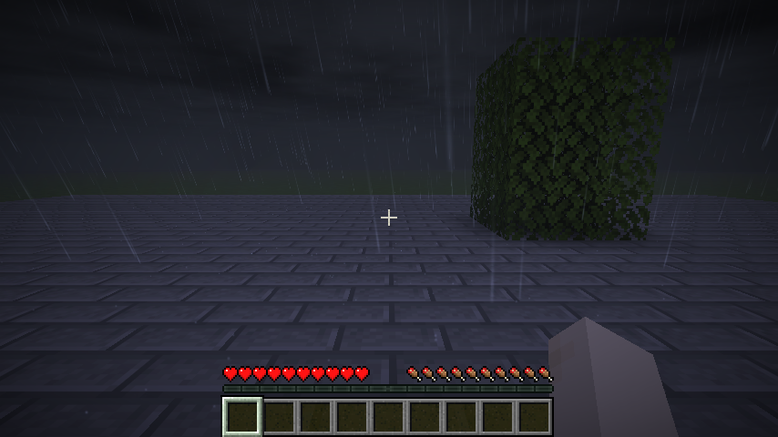
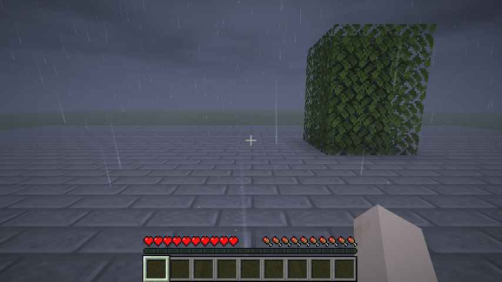

<p align="center"></p>

<h1 align="center">Petrichor</h1>
<p align="center"><strong>Rain & Storms</strong><br>Minecraft 26.3 · Fabric · Unofficial port</p>
<p align="center"><a href="https://github.com/ibraheemrizwan/petrichor-26.3/releases/latest"><strong>Download</strong></a> · <a href="#installation">Installation</a> · <a href="#gallery">Gallery</a> · <a href="https://github.com/ibraheemrizwan/petrichor-26.3/issues">Report a port issue</a> · <a href="https://github.com/Pocky-l/petrichor">Original project</a></p>

<p align="center">   <a href="LICENSE"></a></p>

Rain that builds and eases, puddles and runoff, branching lightning, delayed thunder, and sun showers with rainbows.

<p align="center"><br><sub>Original-mod showcase and artwork by Pocky. Screenshots of this 26.3 port appear in the gallery below.</sub></p>

## Features

- Drizzle, rain, downpours, thunderstorms and sun showers.
- Puddles, splashes, runoff and drips from roofs and leaves.
- Lightning, thunder, weather lighting and a positional rain soundscape.

## Installation

| Dependency | Version |
|---|---|
| Minecraft | 26.3 |
| Java | 25 |
| Fabric Loader | 0.19.5 or newer |
| Fabric API | [0.161.0+26.3 or newer](https://modrinth.com/mod/fabric-api/versions?g=26.3) |

Download the **1.7.0+26.3.port.1** mod JAR from [Releases](https://github.com/ibraheemrizwan/petrichor-26.3/releases/latest), then place it in your `mods` folder with its dependencies. Install the matching versions on the client and server for synchronized features. Replace older copies of the same mod.

This repository provides a Fabric build. Original mod and artwork: **Pocky**. Port maintenance: **ibraheemrizwan**.

## Gallery

These screenshots were captured in Minecraft 26.3 during the port’s automated client tests. They show the test scenes and the default renderer.





## Validation and compatibility

The recorded release passed **31 server GameTests**. The full four-port suite passed **136 server GameTests**, 26 additional kernel checks, dedicated-server integration, and client checks covering resource reload and saved-world reload. See [validation.json](validation.json) for release hashes and [TESTING.md](TESTING.md) for scope.

The default renderer and the Hoarfrost/Petrichor pair were tested. External shader packs, Serene Seasons, Distant Horizons and Sable Companion were not validated for this port.

## Build from source

Install **JDK 25**, then run:

```sh
./gradlew build
```

On Windows, run `gradlew.bat build`. The mod JAR is written to `build/libs/`. The Gradle wrapper downloads its build tools and dependencies.

The port uses Loom 1.17.21, Gradle 9.6.0, Fabric Loader 0.19.5 and Fabric API 0.161.0+26.3. Dependencies used only for compilation are not bundled into the mod JAR.

## Credits and license

Original [source, design and artwork](https://github.com/Pocky-l/petrichor) by **Pocky**, distributed under the [MIT license](LICENSE). This independent port preserves the original credits and is not an official upstream release. See [NOTICE.md](NOTICE.md).

## More Minecraft 26.3 ports

[Exposure](https://github.com/ibraheemrizwan/exposure-26.3) · [Catalog](https://github.com/ibraheemrizwan/exposure-catalog-26.3) · [Polaroid](https://github.com/ibraheemrizwan/exposure-polaroid-26.3) · [Envelope](https://github.com/ibraheemrizwan/envelope-26.3) · [Hoarfrost](https://github.com/ibraheemrizwan/hoarfrost-26.3) · [Petrichor](https://github.com/ibraheemrizwan/petrichor-26.3) · [Diegesis](https://github.com/ibraheemrizwan/diegesis-26.3) · [Hands-On Delight](https://github.com/ibraheemrizwan/handson-delight-26.3)
